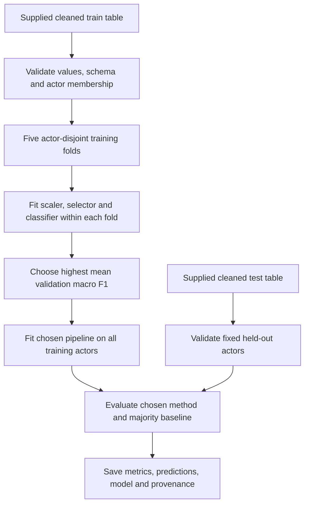

# Coherence with the academic analysis

The research questions and task definitions remain the guide for the rebuild.
Methods are rebuilt incrementally, with explicit data and evaluation choices.
Existing notebooks and saved results remain untouched.

| Original work | Rebuilt work | Explicit differences / remaining work |
| --- | --- | --- |
| `data_exploration.ipynb` | Schema, class-count, finite-value and split audits; majority baseline | Full categorical exploration and plots remain pending; retain all eight emotions in these workflows |
| `ensemble_gradient_boosting.ipynb` | Numeric-only cleaned feature loading; random forest using log-loss, minimum leaf 10, minimum split 5 | Add seed 42; fixed forest settings, no grid search; boosting/bagging variants remain pending |
| `dim_reduction.ipynb`: decision tree | Scaled numeric features and classifier with minimum leaf 5 | Use the coherent cleaned train/test pair; the historical notebook's `Test_ripulito` input is absent |
| PCA | Two components, StandardScaler, decision tree | Fit scaler and PCA within training folds; preserve transform for test data |
| RFE | Decision-tree selector retaining two features, step 1; downstream tree | Fit against true labels, replacing the original use of prior predictions |
| SelectKBest | Ten features, default ANOVA score, downstream tree | Fit selection within training folds |
| SelectFromModel | Decision-tree selector with default threshold, downstream tree | Fit selection within training folds |
| MDS, Isomap, t-SNE | Pending | Preserve as exploration; historical training-set reports are not held-out performance |
| `SVM.ipynb` | Binary task, scaled LinearSVC C variants, kernel explorations and full SVC grid | Same exclusions/mapping; use coherent cleaned pair because original test file is absent; actor-fold selection and explicit defaults/seeds |
| Gradient boosting | Original 27-entry space, ten random samples, 100 stages, classifier seed 0 | Seed the sampler; fit scaling within actor folds; select by mean accuracy |
| XGBoost | Original learning-rate/gamma/tree-method space, ten samples, objective and fixed depth/penalty/seed | Current optional library, fitted label encoder, explicit CPU/thread count; deprecated unused label-encoder flag omitted |
| LightGBM / CatBoost | Pending | Dependencies unavailable in the tested local environment |
| Bagging / AdaBoost | Pending | Preserve forest-as-base-estimator design; legacy AdaBoost default algorithm requires compatible software or a separate methodological decision |
| `regression.ipynb` | Five families, original alpha/forest spaces, 47 candidates, kur target and 202 predictors | Train-fitted metadata encoding/scaling, actor-fold MSE selection, explicit new forest/sampling seed; saved linear result differs |
| `Neural.ipynb` | Five variants and original 15-trial search validated | Original 202 predictors and architecture settings; actor validation/seed, direct Keras and native checkpoints; dropout 51.28%, tuned model 51.44%; legacy checkpoints reproduce saved scores |
| `ravdess_timeseries_import.ipynb` | WAV-to-array import rebuilt; both raw NPY hashes identical | Mono/stereo PCM decoding, actor order, train-derived padding/clipping; compressed candidate close but not identical |
| Time-series classification | Original interval/per-recording min-max/Euclidean 1-NN rebuilt for both targets | Actor-CV selection; emotion 12.82% differs from saved rounded 17%; vocal 58.17% matches rounded 58%; full vocal MiniROCKET 98.56% validated; unfinished full emotion comparison cancelled |
| DTW/SAX | Original SAX preprocessing matches all rows; original DTW defaults implemented and fixture-validated | Full evaluations cancelled at user request; preserve partial checkpoints and report original saved scores |
| Shapelets, clustering and motifs | Preprocessing/window inventory documented; full rebuild incomplete | Keep target, interval, representation, and seed differences; use existing outputs; no invented metrics or comparable large reruns |
| LIME / LORE | Pending | Preserve explanation aims; reference distribution and evaluation split must be explicit |

## Training and evaluation flow

Actor-based validation is a deliberate addition that follows the actor-held-out
test logic already present in the academic audio import. It differs from the
original sample-based CV. Seeds for previously unseeded estimators are explicit
new choices. Method order, reduction sizes and the selection criterion are fixed
in configuration before this comparison; no test-based parameter search occurs.

The test partition was previously examined for the initial baseline and historical
comparisons. It is therefore not a previously unseen dataset in the wider project,
even though this comparison's selection function receives training data only.

## Limits of the cleaned artifacts

The cleaned workflow preserves the 197 numeric columns used by the historical
ensemble analysis. It excludes categorical metadata just as that notebook does.
This gives a coherent feature-reduction comparison; it is not an exact reproduction
of the older dimensionality notebook's positional feature/categorical treatment.

The absence of the cleaning implementation means its original selection criteria,
outlier detector and possible use of test information cannot be established.
Training-fold isolation applies to the new scaler/selector/classifier stages; it
does not establish end-to-end leakage-free generation of the supplied artifacts.

Both workflows reject nonfinite values instead of introducing imputation. No new
rows are removed, no features are silently intersected between datasets, and no
missing test table is substituted for a mismatched training table.

API references: [GroupKFold](https://scikit-learn.org/1.8/modules/generated/sklearn.model_selection.GroupKFold.html),
[Pipeline](https://scikit-learn.org/1.8/modules/generated/sklearn.pipeline.Pipeline.html),
[RFE](https://scikit-learn.org/1.8/modules/generated/sklearn.feature_selection.RFE.html).
